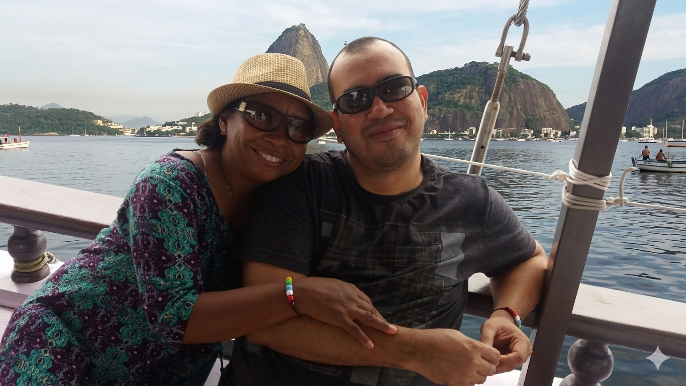

# Viagem ao Rio de Janeiro

## 📒 Descrição

Projeto simples de alteração de fotografia utilizando IAs Generativas.

## 🤖 Tecnologias Utilizadas

Foram utilizadas:

- [ChatGPT](https://chatgpt.com)

- [Gemini](https://gemini.google.com/app)

## 🧐 Processo de Criação

Utilizando a técnica de *Meta Prompting* solicitei ao **ChatGPT** que criasse o prompt final a ser utilizado no **Gemini**.

Prompt inicial:

```
Crie um prompt para ser utilizado para modificar uma fotografia tirada numa escuna, na baía de todos os santos, transformando-a numa foto tirada no Rio de Janeiro, com o Pão de Açúcar ao fundo, mantendo-a totalmente realista, sem modificar os personagens principais da foto.
```

Prompt final:

```
Transform this photo taken on a schooner in the Bay of All Saints into a realistic photo taken in Rio de Janeiro. Replace the background with the iconic Sugarloaf Mountain (Pão de Açúcar) and the surrounding Guanabara Bay landscape. Maintain natural lighting consistent with the original image, adjusting only what is necessary to match Rio’s environment.

Preserve the main subjects exactly as they are — do not alter faces, bodies, clothing, expressions, or positions. Keep skin tones, details, and proportions unchanged.

Ensure the final image is highly realistic, with accurate perspective, depth, reflections on water, and atmospheric conditions typical of Rio de Janeiro. Match colors, shadows, and highlights seamlessly so the scene looks like an authentic photograph taken in Rio.

Avoid any artificial or stylized look. No filters, no exaggerations, no distortions. The result should be indistinguishable from a real photo.
```

## 🚀 Resultado

